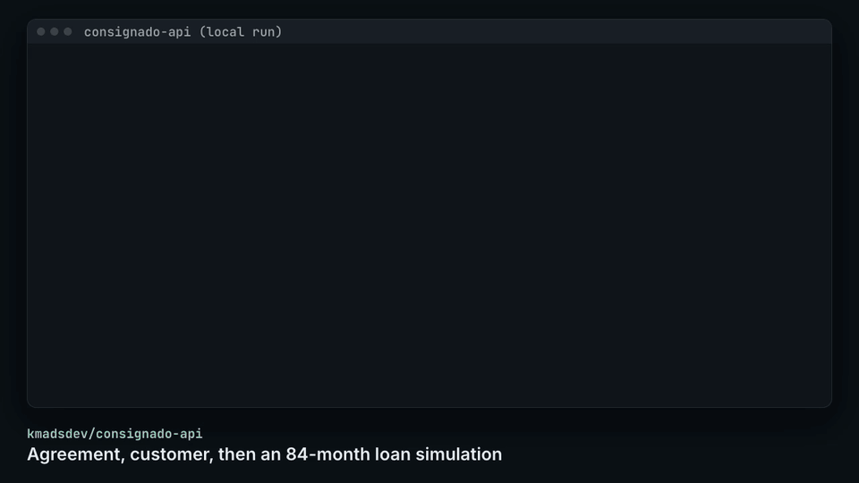
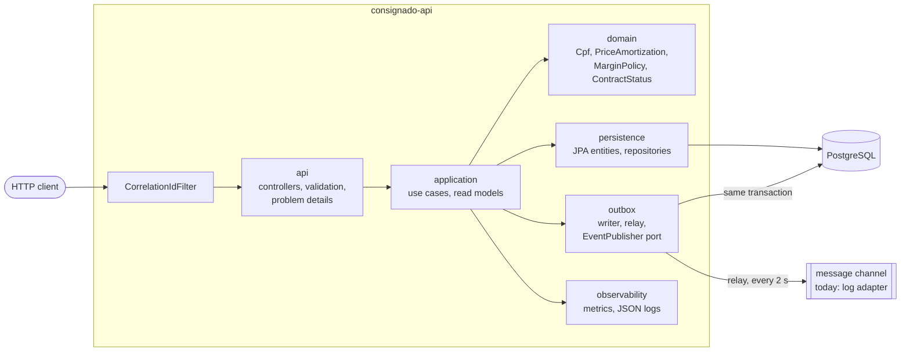
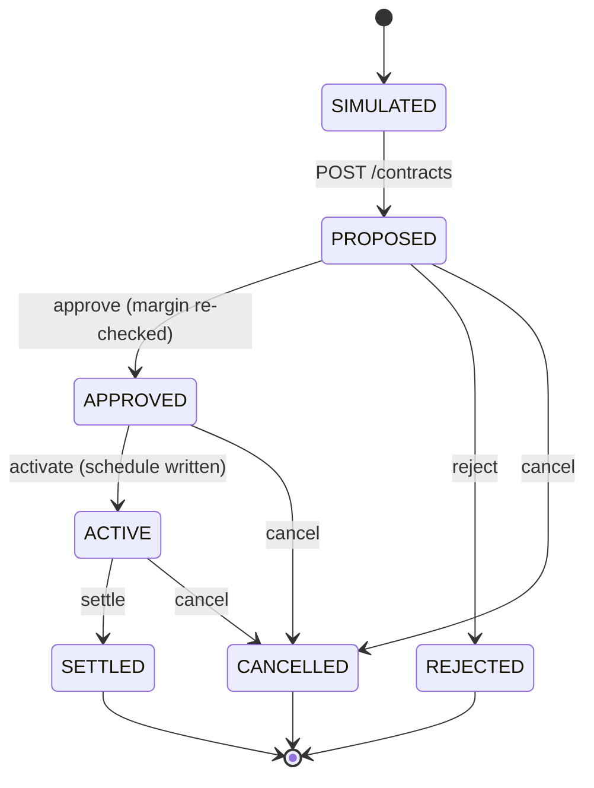

# consignado-api

A REST API for payroll-deducted loans (crédito consignado): employer agreements, customers, loan simulations with a Price amortization schedule, and the contract lifecycle up to settlement.

This is a study project I built to practice backend design on a real banking product. It has no real customers. A public demo of it runs on Azure with synthetic data only (see the Platform section).

Leia em português: [README.pt-br.md](README.pt-br.md)



*Local run of the README walkthrough.*

## Platform: this API runs live on two Azure hosts

The same jar runs as pods on AKS and inside an Azure Function, behind a Java gateway and a Cloudflare edge, at <https://consignado.kmads.dev>.
The AKS cluster is stopped by default; a signed-in user starts it for a 15-minute access window.

- Start here: [docs/platform/README.md](docs/platform/README.md) (what is live, what is not verified)
- [Architecture diagrams](docs/platform/architecture.md) · [Decisions](docs/platform/decisions.md) · [Runbook](docs/platform/operations.md)
- [Security and privacy](docs/platform/security-and-privacy.md) · [Product decisions](docs/platform/business.md) · ADRs 0008 to 0012 in [docs/adr](docs/adr)

## What it does

In a consignado loan, the installment is deducted from the borrower's paycheck, so the employer agreement (convênio) caps how much of the net salary installments may take (the consignable margin) and how long the loan may run. This API:

- registers agreements with their margin cap, term cap and monthly rate;
- registers customers with a validated CPF (always returned masked);
- simulates a loan: fixed installment, full schedule, total payable, and a check against the margin that is free right now;
- turns a simulation into a contract and moves it through `PROPOSED -> APPROVED/REJECTED -> ACTIVE -> SETTLED/CANCELLED`, checking the margin again on approval;
- writes the installment schedule when the contract becomes active;
- publishes every status change as an event through a transactional outbox.

## Stack

Java 21, Spring Boot 3.5, Spring Data JPA (Hibernate), PostgreSQL 16, Flyway, Bean Validation, springdoc-openapi, Micrometer with a Prometheus endpoint, JUnit 5, Testcontainers, ArchUnit, JaCoCo, Docker, GitHub Actions.

I chose Spring Boot 3.5 over 4.x for this first version because it is the line I know best and most existing Spring code still runs on it. Moving to 4.x is listed under "what is not built".

## Architecture



The `domain` package is plain Java with no framework imports. `ArchitectureTest` (ArchUnit) fails the build if a controller reaches a repository, or if the domain imports Spring or JPA. Details in [ADR 0001](docs/adr/0001-layering.md).

Contract lifecycle:



## How to run

You need Docker. To run the tests outside Docker you also need JDK 21.

```bash
# App + PostgreSQL. Migrations run on startup.
docker compose up --build

# In another terminal
curl -s localhost:8080/actuator/health/readiness
open http://localhost:8080/swagger-ui.html      # OpenAPI UI
```

The compose file uses throwaway development credentials with defaults. Override them with `POSTGRES_USER` and `POSTGRES_PASSWORD`. Ports can move with `APP_PORT` and `POSTGRES_PORT`.

Tests:

```bash
./mvnw verify        # unit, slice, integration (needs Docker for Testcontainers), JaCoCo
open target/site/jacoco/index.html
```

Without a local JDK 21, the same build runs in a container:

```bash
docker run --rm -v "$PWD":/work -w /work \
  -v /var/run/docker.sock:/var/run/docker.sock \
  -e TESTCONTAINERS_HOST_OVERRIDE=host.docker.internal \
  maven:3.9.11-eclipse-temurin-21 ./mvnw -B verify
```

Configuration (environment variables): `DB_URL`, `DB_USERNAME`, `DB_PASSWORD`. Application settings live under `consignado.*` in `application.yml` (simulation validity, outbox poll interval, batch size, max attempts).

## API examples

The outputs below are from a local run, shortened.

**1. Agreement** (35% margin cap, up to 96 months, 1.85% per month):

```bash
curl -s -X POST localhost:8080/api/v1/agreements -H 'Content-Type: application/json' -d '{
  "code": "PUBLIC-SERVANTS", "name": "Example agreement",
  "maxMarginPercent": 35, "maxTermMonths": 96, "monthlyInterestRate": 0.0185 }'
```

**2. Customer.** Any CPF with valid check digits works. The response masks it: `"cpf": "***.***.***-04"`.

```bash
curl -s -X POST localhost:8080/api/v1/customers -H 'Content-Type: application/json' -d '{
  "cpf": "<11 digits>", "fullName": "Maria Example",
  "agreementId": "<agreement id>", "netMonthlySalary": 4200.00 }'
```

**3. Simulation**: R$ 15,000.00 over 84 months.

```bash
curl -s -X POST localhost:8080/api/v1/simulations -H 'Content-Type: application/json' -d '{
  "customerId": "<customer id>", "amount": 15000.00, "termMonths": 84 }'
```

```json
{
  "installmentAmount": 353.24,
  "totalPayable": 29672.96,
  "availableMargin": 1470.00,
  "schedule": [
    { "number": 1,  "dueDate": "2026-12-13", "amount": 353.24, "interest": 277.50, "amortization": 75.74,  "remainingBalance": 14924.26 },
    { "number": 84, "dueDate": "2033-11-13", "amount": 354.04, "interest": 6.43,   "amortization": 347.61, "remainingBalance": 0.00 }
  ]
}
```

The last installment is 0.80 higher than the others because it absorbs the rounding remainder, so the margin check uses that largest installment, not only the regular one ([ADR 0002](docs/adr/0002-money-and-rounding.md)).

**4. Contract** with an idempotency key:

```bash
curl -si -X POST localhost:8080/api/v1/contracts -H 'Content-Type: application/json' \
  -H 'Idempotency-Key: 7d0c2a52-6f1e-4c8b-9d0e-1a2b3c4d5e6f' \
  -d '{ "simulationId": "<simulation id>" }'
# HTTP/1.1 201, Location: .../api/v1/contracts/<id>, ETag: "0"
# The same request again returns 200 with the same contract.
```

**5. Lifecycle** with optimistic concurrency:

```bash
curl -s -X POST localhost:8080/api/v1/contracts/<id>/approve  -H 'If-Match: "0"'   # 200, version 1
curl -s -X POST localhost:8080/api/v1/contracts/<id>/activate -H 'If-Match: "0"'   # 412, stale version
curl -s -X POST localhost:8080/api/v1/contracts/<id>/activate -H 'If-Match: "1"'   # 200, schedule written
curl -s localhost:8080/api/v1/contracts/<id>/installments
curl -s 'localhost:8080/api/v1/contracts?customerId=<customer id>&status=ACTIVE&page=0&size=20'
curl -s localhost:8080/api/v1/customers/<customer id>/margin
```

### Errors

Every error is `application/problem+json` (RFC 9457, which replaced RFC 7807) with a stable `code` and the request's `correlationId`:

```json
{
  "type": "urn:consignado:problem:version-mismatch",
  "title": "Precondition failed",
  "status": 412,
  "detail": "Expected version 0 but the current version is 1",
  "code": "version-mismatch",
  "correlationId": "336ad54f-3791-4d1e-b10c-1f53b6c3abc2"
}
```

| Status | Codes |
|---|---|
| 400 | `validation-failed` (with an `errors` list of field and message) |
| 404 | `not-found` |
| 409 | `illegal-status-transition`, `simulation-already-used`, `customer-already-exists`, `agreement-code-taken`, `concurrent-update`, `data-conflict` |
| 412 | `version-mismatch` |
| 422 | `margin-exceeded` (with `availableMargin` and `installment`), `term-above-agreement-limit`, `term-too-long-for-amount`, `simulation-expired`, `idempotency-key-reused`, `invalid-cpf`, `customer-not-found`, `agreement-not-found`, `simulation-not-found` |
| 500 | `internal-error` (no internal detail in the body) |

Errors that Spring MVC raises before a controller runs (unknown route, wrong method, unreadable JSON, a path id that is not a UUID) are also problem details with a `correlationId`, but with `type: about:blank` and no `code`.

## Design decisions

| ADR | Decision |
|---|---|
| [0001](docs/adr/0001-layering.md) | Layered packages, pure-Java domain, enforced by ArchUnit |
| [0002](docs/adr/0002-money-and-rounding.md) | `BigDecimal`, HALF_EVEN, last installment absorbs the remainder, margin rounds down; IOF and CET left out on purpose |
| [0003](docs/adr/0003-contract-states-and-concurrency.md) | One transition table; `@Version` + ETag/If-Match per contract; row lock on the customer to stop two approvals from both using the same margin |
| [0004](docs/adr/0004-idempotent-contract-creation.md) | `Idempotency-Key` backed by a unique constraint; concurrent duplicates resolve to the same contract |
| [0005](docs/adr/0005-transactional-outbox.md) | Transactional outbox, `SKIP LOCKED` relay, `EventPublisher` port; where a broker adapter plugs in |
| [0006](docs/adr/0006-observability.md) | Correlation id, JSON logs, readiness vs liveness, business metrics, no CPF in logs or URLs |

Some smaller choices:

- Flyway owns the schema; Hibernate runs with `ddl-auto=validate`, so a mapping that drifts from the schema fails at startup and in tests.
- Each index matches a query: the margin sum and listing by customer (`customer_id, status`), back-office listing (`status, created_at`), installments by contract (unique `contract_id, number`), and a partial index on unpublished outbox rows.
- `open-in-view` is off. Use cases return records, so nothing lazy reaches the JSON layer.
- Timestamps are stored in UTC. Due dates use the `America/Sao_Paulo` calendar.
- A single `Clock` bean, so tests can move time (simulation expiry is tested that way).

## Tests

| Kind | Classes | What they cover |
|---|---|---|
| Unit | `CpfTest`, `PriceAmortizationTest`, `MarginPolicyTest`, `ContractStatusTest`, `ETagsTest`, `CorrelationIdFilterTest`, `JsonLogFormatterTest` | Check digits, a hand-computed schedule, HALF_EVEN ties, zero rate, 420-month schedules, margin rounding, all 49 status pairs |
| Web slice | `ContractControllerTest` (`@WebMvcTest`) | Status codes, headers, problem bodies, validation, nothing leaked on 500 |
| Repository | `PersistenceIT` (`@DataJpaTest` + PostgreSQL) | Migrations, constraints, optimistic locking, margin sum, pagination |
| Integration | `ContractLifecycleIT`, `OutboxIT`, `ObservabilityIT` (full app + PostgreSQL over HTTP) | Full lifecycle, concurrent idempotent creates, concurrent approvals, outbox ordering and retry, probes and metrics |
| Architecture | `ArchitectureTest` (ArchUnit) | Layer rules, pure domain, constructor injection |

Test CPFs are generated at runtime with valid check digits; there is no real CPF in the repository. The build fails below 80% line coverage (JaCoCo); the last run was at about 94%.

## What is not built

- **IOF and CET.** Not computed; see [ADR 0002](docs/adr/0002-money-and-rounding.md).
- **Authentication and authorization.** Every endpoint is open. A real version needs OAuth2 resource-server tokens and roles (an operator approves, a customer only simulates).
- **Payments.** Installments are not marked as paid; settlement is a manual status change. No early payoff, no refinancing (refinanciamento) and no portability.
- **Real payroll integration.** No reservation of margin at the employer's system (averbação), no payroll file exchange.
- **A real broker adapter.** Events go to the log. The outbox and the port are ready for one ([ADR 0005](docs/adr/0005-transactional-outbox.md)).
- **Customer data protection beyond masking.** The CPF is stored in plain text. A real system would encrypt or tokenize it and log access to it.
- **Several employments per customer.** A customer belongs to one agreement.
- **Outbox housekeeping.** No cleanup of published rows, no alert on rows that reached the attempt limit.
- **Tracing.** Correlation id only; no distributed tracing.
- **Spring Boot 4.x.** This version stays on 3.5.

## License

To be decided by the owner.
