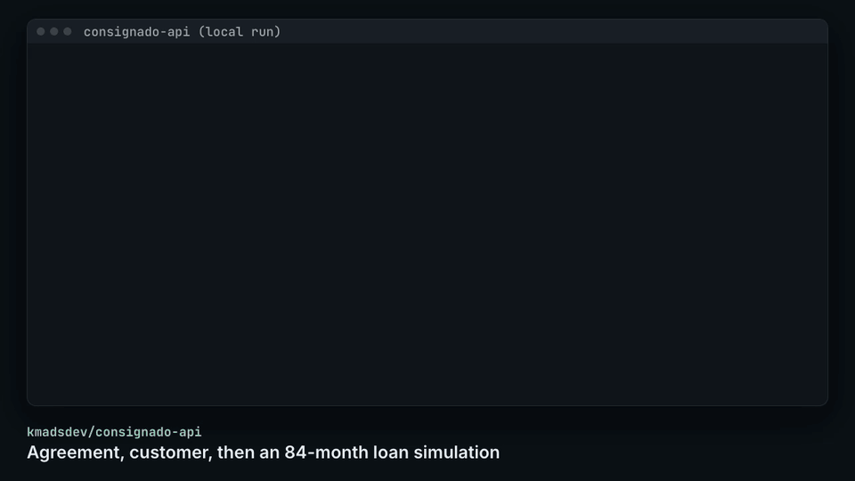
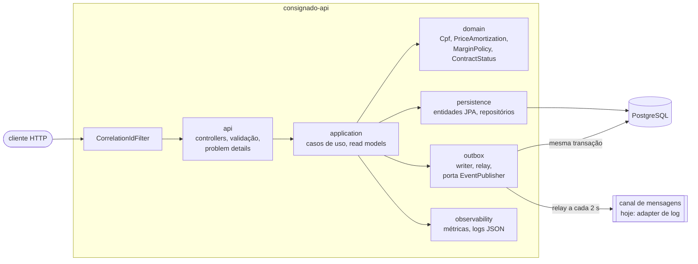
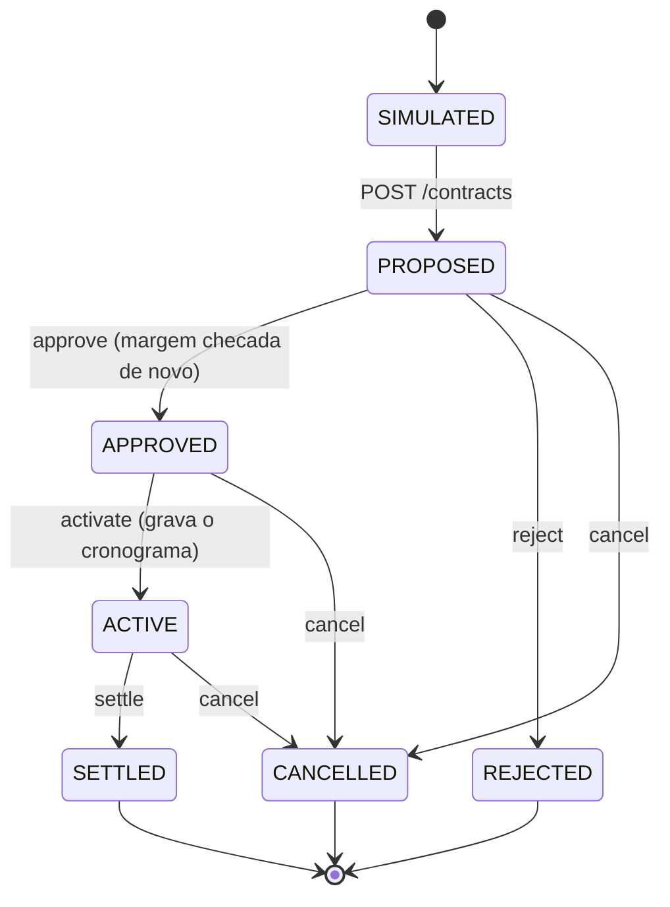

# consignado-api

API REST de crédito consignado: convênios, clientes, simulação com tabela Price e o ciclo de vida do contrato até a quitação.

É um projeto de estudo que fiz para praticar design de backend em cima de um produto bancário de verdade. Não tem usuários e não roda em produção.

Read in English: [README.md](README.md)



*Execução local do passo a passo do README.*

## O que ele faz

No consignado, a parcela é descontada direto da folha de pagamento. Por isso o convênio com o empregador limita quanto do salário líquido as parcelas podem comprometer (a margem consignável) e qual o prazo máximo. A API:

- cadastra convênios com margem máxima, prazo máximo e taxa mensal;
- cadastra clientes com CPF validado (a resposta sempre devolve o CPF mascarado);
- simula o empréstimo: parcela fixa, cronograma completo, total a pagar e checagem contra a margem livre naquele momento;
- faz uma prévia para o visitante sem cadastro: o mesmo cálculo, sem ler nem gravar nada no banco;
- lista convênios, clientes, simulações e contratos, do mais novo para o mais antigo;
- altera a renda do cliente, mas só se a nova margem ainda cobrir as parcelas já comprometidas;
- transforma a simulação em contrato e conduz o contrato por `PROPOSED -> APPROVED/REJECTED -> ACTIVE -> SETTLED/CANCELLED`, checando a margem de novo na aprovação;
- grava o cronograma de parcelas quando o contrato é ativado;
- publica cada mudança de status como evento via transactional outbox.

## Stack

Java 21, Spring Boot 3.5, Spring Data JPA (Hibernate), PostgreSQL 16, Flyway, Bean Validation, springdoc-openapi, Micrometer com endpoint Prometheus, JUnit 5, Testcontainers, ArchUnit, JaCoCo, Docker e GitHub Actions.

Fiquei no Spring Boot 3.5 em vez do 4.x nesta primeira versão porque é a linha que conheço melhor e a maior parte do código Spring que existe por aí ainda roda nela. A migração para o 4.x está na lista do que não foi feito.

## Arquitetura



O pacote `domain` é Java puro, sem import de framework. O `ArchitectureTest` (ArchUnit) quebra o build se um controller acessar um repositório ou se o domínio importar Spring ou JPA. Detalhes na [ADR 0001](docs/adr/0001-layering.md).

Ciclo de vida do contrato:



## Como rodar

Precisa de Docker. Para rodar os testes fora do Docker, precisa também do JDK 21.

```bash
# App + PostgreSQL. As migrations rodam na subida.
docker compose up --build

# Em outro terminal
curl -s localhost:8080/actuator/health/readiness
open http://localhost:8080/swagger-ui.html      # UI do OpenAPI
```

O compose usa credenciais descartáveis de desenvolvimento, com valor padrão. Dá para trocar com `POSTGRES_USER` e `POSTGRES_PASSWORD`, e as portas com `APP_PORT` e `POSTGRES_PORT`.

Testes:

```bash
./mvnw verify        # unitários, slice, integração (Testcontainers precisa de Docker), JaCoCo
open target/site/jacoco/index.html
```

Sem JDK 21 na máquina, o mesmo build roda num container:

```bash
docker run --rm -v "$PWD":/work -w /work \
  -v /var/run/docker.sock:/var/run/docker.sock \
  -e TESTCONTAINERS_HOST_OVERRIDE=host.docker.internal \
  maven:3.9.11-eclipse-temurin-21 ./mvnw -B verify
```

Configuração por variável de ambiente: `DB_URL`, `DB_USERNAME`, `DB_PASSWORD`. As configurações da aplicação ficam em `consignado.*` no `application.yml` (validade da simulação, intervalo do outbox, tamanho do lote, número máximo de tentativas).

## Implantação

`deploy/k8s` tem os manifests do Kubernetes e `deploy/render.sh` preenche os `${VAR}` deles (`IMAGE`, `APP_CLIENT_ID`, `TENANT_ID`, `KV`, `PG_HOST`, `PG_DB`, `PG_ADMIN`; nenhum é segredo). O Service é um load balancer interno do Azure com o IP privado fixo `10.10.3.200`, então a API não tem endereço público. A senha do banco vem do Key Vault via workload identity e o driver Secrets Store CSI.

O job `deploy` em `.github/workflows/ci.yml` roda a cada push na `main`: login OIDC, imagem no registry, liga o cluster se ele estiver parado, `kubelogin` (Entra ID com Azure RBAC, sem conta local), apply, rollout, smoke test de dentro do cluster e checagem do IP do load balancer. Ele nunca desliga o cluster; quem desliga é o timer do gateway. Os motivos estão na [ADR 0007](docs/adr/0007-two-hosts-one-api.md).

## Exemplos de uso

As saídas abaixo vieram de uma execução local, resumidas.

**1. Convênio** (margem de 35%, até 96 meses, 1,85% ao mês):

```bash
curl -s -X POST localhost:8080/api/v1/agreements -H 'Content-Type: application/json' -d '{
  "code": "PUBLIC-SERVANTS", "name": "Example agreement",
  "maxMarginPercent": 35, "maxTermMonths": 96, "monthlyInterestRate": 0.0185 }'
```

**2. Cliente.** Qualquer CPF com dígitos verificadores válidos serve. A resposta mascara: `"cpf": "***.***.***-04"`.

```bash
curl -s -X POST localhost:8080/api/v1/customers -H 'Content-Type: application/json' -d '{
  "cpf": "<11 dígitos>", "fullName": "Maria Example",
  "agreementId": "<id do convênio>", "netMonthlySalary": 4200.00 }'
```

**3. Simulação**: R$ 15.000,00 em 84 meses.

```bash
curl -s -X POST localhost:8080/api/v1/simulations -H 'Content-Type: application/json' -d '{
  "customerId": "<id do cliente>", "amount": 15000.00, "termMonths": 84 }'
```

```json
{
  "installmentAmount": 353.24,
  "totalPayable": 29672.96,
  "availableMargin": 1470.00,
  "schedule": [
    { "number": 1,  "dueDate": "2026-12-13", "amount": 353.24, "interest": 277.50, "amortization": 75.74,  "remainingBalance": 14924.26 },
    { "number": 84, "dueDate": "2033-11-13", "amount": 354.04, "interest": 6.43,   "amortization": 347.61, "remainingBalance": 0.00 }
  ]
}
```

A última parcela sai R$ 0,80 maior que as outras porque ela absorve a sobra do arredondamento. Por isso a checagem de margem usa a maior parcela do cronograma, e não só a parcela regular ([ADR 0002](docs/adr/0002-money-and-rounding.md)).

**4. Contrato** com chave de idempotência:

```bash
curl -si -X POST localhost:8080/api/v1/contracts -H 'Content-Type: application/json' \
  -H 'Idempotency-Key: 7d0c2a52-6f1e-4c8b-9d0e-1a2b3c4d5e6f' \
  -d '{ "simulationId": "<id da simulação>" }'
# HTTP/1.1 201, Location: .../api/v1/contracts/<id>, ETag: "0"
# A mesma requisição de novo devolve 200 com o mesmo contrato.
```

**5. Ciclo de vida** com controle de concorrência otimista:

```bash
curl -s -X POST localhost:8080/api/v1/contracts/<id>/approve  -H 'If-Match: "0"'   # 200, versão 1
curl -s -X POST localhost:8080/api/v1/contracts/<id>/activate -H 'If-Match: "0"'   # 412, versão velha
curl -s -X POST localhost:8080/api/v1/contracts/<id>/activate -H 'If-Match: "1"'   # 200, cronograma gravado
curl -s localhost:8080/api/v1/contracts/<id>/installments
curl -s 'localhost:8080/api/v1/contracts?customerId=<id do cliente>&status=ACTIVE&page=0&size=20'
curl -s localhost:8080/api/v1/customers/<id do cliente>/margin
```

**6. Listagens**, da mais nova para a mais antiga. Clientes, simulações e contratos são paginados (`page` de 0 a 10000, `size` de 1 a 100, padrão 20) e usam o mesmo envelope; convênios vêm como um array simples.

```bash
curl -s 'localhost:8080/api/v1/customers?page=0&size=20'
curl -s 'localhost:8080/api/v1/simulations?page=0&size=20'    # resumos: listagem não traz cronograma
curl -s localhost:8080/api/v1/agreements
```

```json
{ "content": [ { "id": "...", "cpf": "***.***.***-04", "fullName": "Maria Example", "netMonthlySalary": 4200.00 } ],
  "page": 0, "size": 20, "totalElements": 1, "totalPages": 1 }
```

**7. Alteração de renda.** É a única atualização fora do fluxo do contrato; não existe `DELETE` nem outro `PATCH` ou `PUT`. O novo limite (renda x a margem do convênio, arredondado para baixo) precisa cobrir as parcelas dos contratos APPROVED e ACTIVE.

```bash
curl -s -X PATCH localhost:8080/api/v1/customers/<id do cliente>/income \
  -H 'Content-Type: application/json' -d '{ "monthlyIncome": 1000.00 }'
# 200 com o cliente, ou, com o contrato de 353,24 acima aprovado (35% de 1000,00 = 350,00):
```

```json
{
  "type": "urn:consignado:problem:income-below-committed-margin",
  "title": "Income below committed margin",
  "status": 422,
  "detail": "The new margin limit 350.00 is below the committed installments 353.24",
  "code": "income-below-committed-margin",
  "marginLimit": 350.00,
  "committedInstallments": 353.24
}
```

A requisição trava a linha do cliente, como a aprovação faz. Assim, um corte de renda e uma aprovação no mesmo instante não passam os dois ([ADR 0003](docs/adr/0003-contract-states-and-concurrency.md), [ADR 0007](docs/adr/0007-two-hosts-one-api.md)).

**8. Prévia** para o visitante sem cadastro. Sem estado: sem repositório, sem transação, nada é gravado. `monthlyIncome` e `maxMarginPercent` são opcionais, mas andam juntos; sem eles os dois campos de margem não aparecem.

```bash
curl -s -X POST localhost:8080/api/v1/simulations/preview -H 'Content-Type: application/json' -d '{
  "principal": 15000.00, "termMonths": 84, "monthlyInterestRate": 0.0185,
  "monthlyIncome": 4200.00, "maxMarginPercent": 35 }'
```

```json
{
  "principal": 15000.00,
  "termMonths": 84,
  "monthlyInterestRate": 0.0185,
  "installment": 353.24,
  "totalAmount": 29672.96,
  "totalInterest": 14672.96,
  "marginLimit": 1470.00,
  "withinMargin": true
}
```

Os números são os do exemplo 3, porque o caminho de código é o mesmo (`PriceAmortization`, `MarginPolicy`). `withinMargin` compara a maior parcela (354,04 aqui) com o limite. Limites: principal de 100,00 a 1.000.000,00, prazo de 1 a 420 meses, taxa de 0 até menos que 1.

### Erros

Todo erro sai como `application/problem+json` (RFC 9457, que substituiu a RFC 7807), com um `code` estável e o `correlationId` da requisição. A tabela de códigos está no [README em inglês](README.md#errors).

## Decisões de design

| ADR | Decisão |
|---|---|
| [0001](docs/adr/0001-layering.md) | Pacotes em camadas, domínio em Java puro, regra garantida por ArchUnit |
| [0002](docs/adr/0002-money-and-rounding.md) | `BigDecimal`, HALF_EVEN, última parcela absorve a sobra, margem arredonda para baixo; IOF e CET ficaram de fora de propósito |
| [0003](docs/adr/0003-contract-states-and-concurrency.md) | Uma tabela de transições; `@Version` + ETag/If-Match por contrato; lock na linha do cliente para duas aprovações não usarem a mesma margem |
| [0004](docs/adr/0004-idempotent-contract-creation.md) | `Idempotency-Key` com unique constraint; requisições duplicadas e concorrentes caem no mesmo contrato |
| [0005](docs/adr/0005-transactional-outbox.md) | Transactional outbox, relay com `SKIP LOCKED`, porta `EventPublisher`; onde um adapter de broker entra |
| [0006](docs/adr/0006-observability.md) | Correlation id, logs JSON, readiness separado de liveness, métricas de negócio, CPF fora de log e de URL |
| [0007](docs/adr/0007-two-hosts-one-api.md) | Dois hosts (AKS e uma function) rodam o mesmo jar no mesmo banco; a API não tem login, só o gateway chega nela; prévia sem estado para visitantes; sem delete e uma única alteração de renda protegida |

As ADRs estão em inglês.

## Testes

- **Unitários** do domínio: dígito verificador do CPF, cronograma conferido à mão, empate do HALF_EVEN, taxa zero, prazos de até 420 meses, arredondamento da margem, a trava da alteração de renda, os 49 pares de status e os números da prévia.
- **Slice web** (`@WebMvcTest`): status, headers, corpo dos erros, validação, limites de paginação, nada vazando num 500. `SimulationPreviewTest` roda a prévia de verdade num contexto sem `DataSource`, sem JPA e sem repositório.
- **Repositório** (`@DataJpaTest` com PostgreSQL de verdade): migrations, constraints, lock otimista, soma da margem, paginação.
- **Integração** (app inteira + PostgreSQL via HTTP): ciclo completo, criação idempotente concorrente, aprovações concorrentes, corte de renda concorrendo com uma aprovação, listagens da mais nova para a mais antiga, prévia igual à simulação gravada, ordem e retry do outbox, probes e métricas.
- **Arquitetura** (ArchUnit): regras de camada e nenhuma dependência de armazenamento na prévia do visitante.

Os CPFs dos testes são gerados na hora com dígitos válidos; não existe CPF real no repositório. O build falha abaixo de 80% de cobertura de linha (JaCoCo); a última execução ficou em torno de 96%.

## O que não foi feito

- **IOF e CET.** Não são calculados; ver [ADR 0002](docs/adr/0002-money-and-rounding.md).
- **Autenticação e autorização dentro da API.** A API não tem login: na plataforma implantada só o gateway chega nela, e é o gateway que valida o token do Entra ID ([ADR 0007](docs/adr/0007-two-hosts-one-api.md)). Rodando local, todos os endpoints estão abertos.
- **Dados por tenant e exclusão.** Todos os usuários veem o mesmo conjunto de dados. Nada pode ser apagado pela API.
- **Pagamentos.** Parcela não é baixada como paga; quitação é uma mudança manual de status. Sem quitação antecipada, refinanciamento ou portabilidade.
- **Integração com a folha.** Sem averbação no sistema do empregador e sem troca de arquivos de folha.
- **Adapter de broker de verdade.** Os eventos vão para o log; o outbox e a porta já estão prontos para isso.
- **Proteção de dados além do mascaramento.** O CPF fica em texto puro no banco.
- **Mais de um vínculo por cliente.** O cliente pertence a um convênio só.
- **Manutenção do outbox.** Sem limpeza de linhas publicadas e sem alerta para linhas que estouraram as tentativas.
- **Tracing distribuído.** Só correlation id.
- **Spring Boot 4.x.** Esta versão fica no 3.5.

## Licença

A definir pelo dono do repositório.
