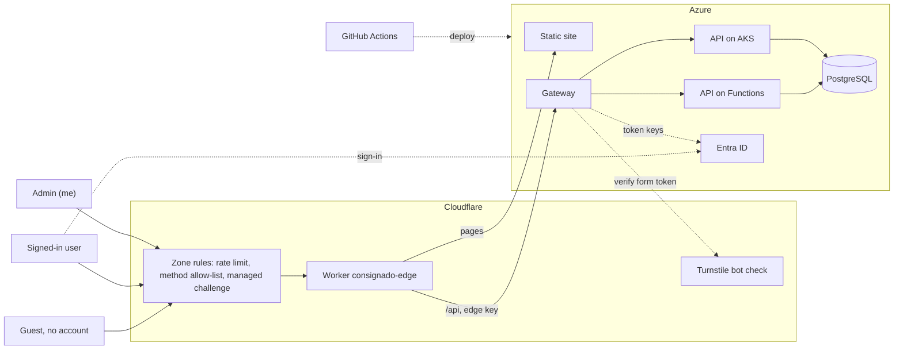
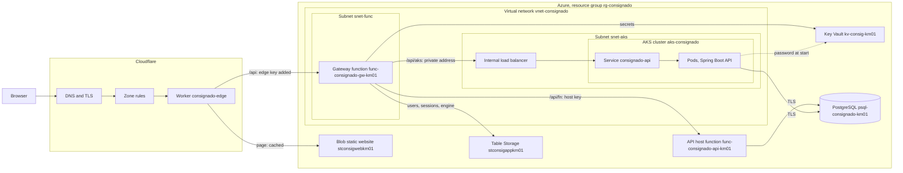
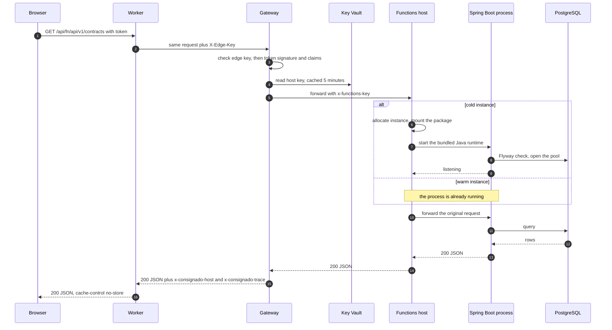
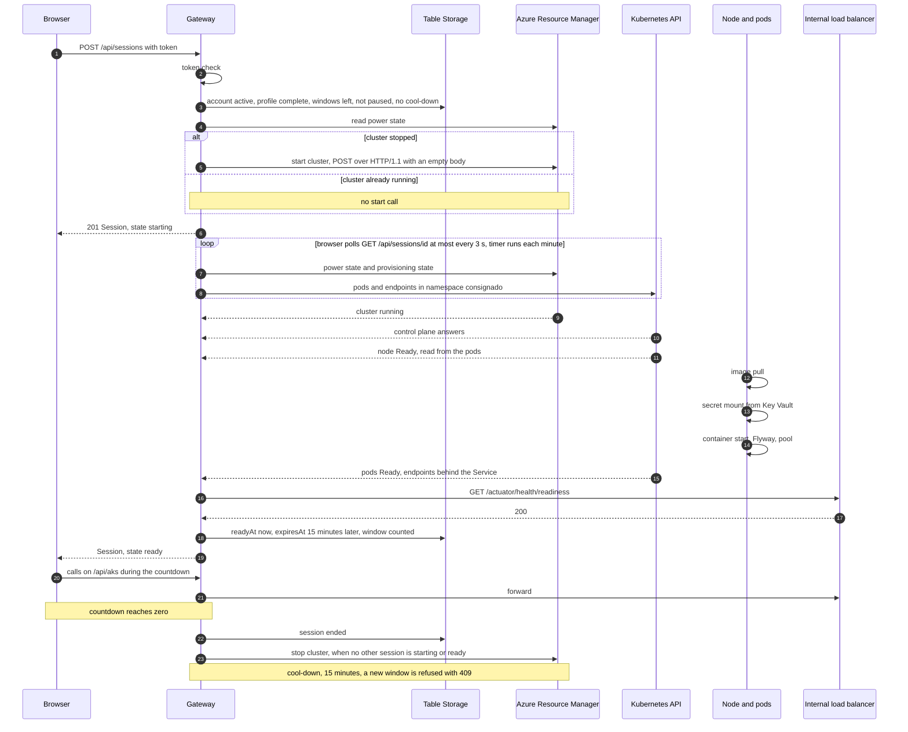
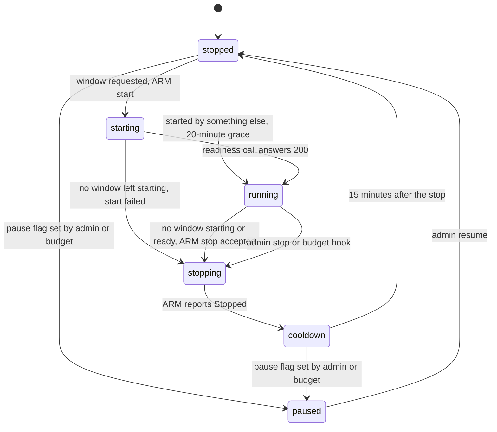
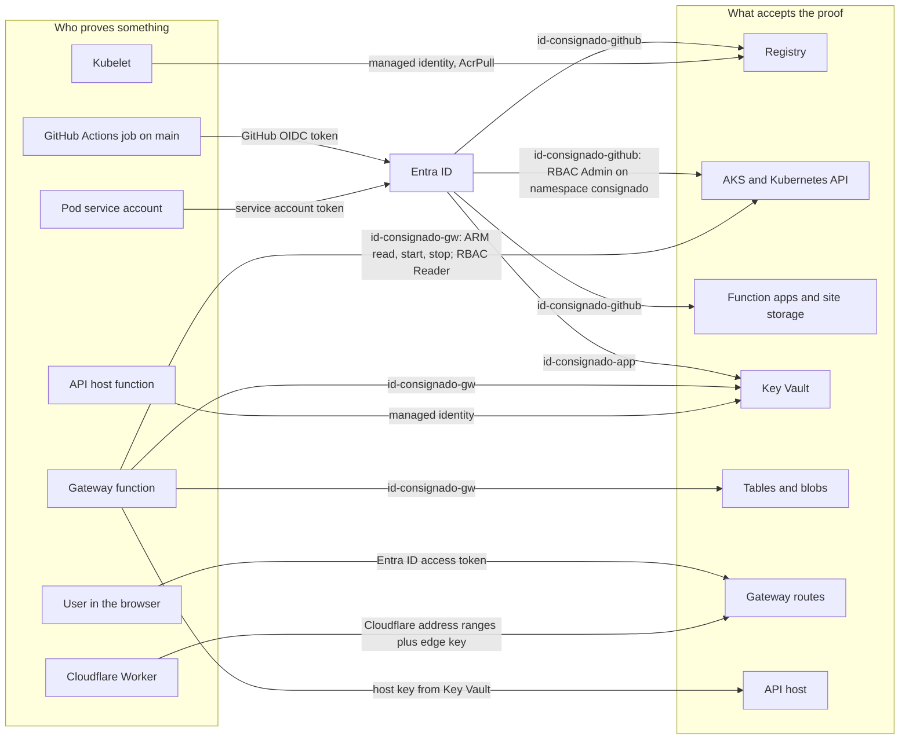
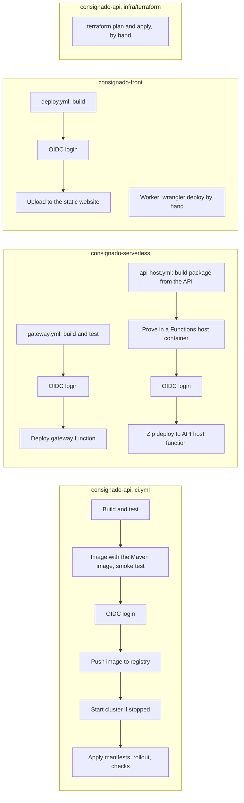

# Architecture

Seven diagrams, each with a short explanation. Names of Azure resources are the real names.
Numbers of time carry their source. The live numbers were measured on 2026-11-17 in the end-to-end test through the edge. Where a number was not measured, the text says so.

Back to the [entry page](README.md).

## a. System context

Three kinds of people use the platform. All of them enter through Cloudflare: first the zone rules (a rate limit of 40 requests per 10 seconds per IP address on `/api/`, a method allow-list, and a managed challenge for non-browser clients on `/api/contact` and `/api/me/profile`), then one Worker.
The Worker sends page requests to the static site and API requests to the gateway.
The gateway is the only caller of the two API hosts. Both hosts run the same jar and use the same database.
Entra ID signs users in. The gateway reads the public signing keys of the tenant to check each token.
GitHub Actions deploys the three repositories. Terraform, which I run by hand, creates the resources.

## b. Page load path and API request path

**Page load.** The Worker serves every path with no file extension as `index.html`, because the router runs in the browser. Files under `/assets/` are cached for one year. Other files are cached for 60 seconds at the edge, and the browser revalidates them (`no-cache`). The Worker adds the security headers (HSTS, a content security policy, no framing).

**API request.** The Worker never caches `/api`. It forwards six request headers (`accept`, `accept-language`, `authorization`, `content-type`, `idempotency-key`, `x-fingerprint`), adds the edge key and the client address that Cloudflare measured, and calls the gateway. The gateway function app accepts only the Cloudflare address ranges. The gateway is integrated with `snet-func`, so it can reach the internal load balancer in `snet-aks`. The API host function accepts inbound calls only from `snet-func`.

**What is not in the virtual network.** PostgreSQL has a public endpoint in a different region (`northcentralus`). See [decisions](decisions.md). The gateway reaches Entra ID, Azure Resource Manager, Key Vault and the internal load balancer through `snet-func` with the default outbound path (verified live: the readiness call through the internal load balancer answered 200 in 248 ms).

## c. One API call on the serverless host, cold and warm

The trace header holds the stages `request`, `edge`, `gateway`, `identity`, `keyvault`, `function-cold-start`, `jvm-start`, `database`, `response` with measured milliseconds. `request` and `edge` have no time: the gateway cannot measure them. The gateway sets `cold=true` only for the Functions host and only when the upstream call took more than 8 seconds. Then `function-cold-start` holds the whole upstream time, because instance allocation and the JVM start cannot be measured apart. The AKS host is never `cold`.

A guest call is the same picture with no token and no database: a guest can call only `POST /api/fn/api/v1/simulations/preview`, and that endpoint has no repository.

Times **measured live** on 2026-11-17, in the browser, through the edge:

| Call | Time |
|---|---|
| Cold call (2 of 2) | 18.6 s to 18.9 s; the trace put 18.6 s in `function-cold-start` |
| Warm guest preview | 0.25 s (trace `totalMs` 23) |
| Warm signed-in calls (11) | 0.55 s to 1.2 s, median 0.9 s (trace median 572 ms) |

The cold call came again 17 minutes after the last call to the host, so a visitor must expect it. The local measure under emulation before the deploy (11.2 s to 12.0 s) did not include instance allocation and package mount, and it was too low.

## d. One access window on the Kubernetes host

The gateway records one lifecycle event per stage, from real signals only: `arm-start`, `control-plane`, `node`, `image-pull`, `secrets-mount`, `container-start`, `database`, `readiness`, `load-balancer`, `first-response`, `window-open`, `window-close`, `cluster-stop`.

The gateway role `Azure Kubernetes Service RBAC Reader` cannot list nodes (they are cluster-scoped). So the gateway reads pods and endpoints first and takes the node state from the pods: a pod with a running container proves that its node is Ready. One `403` line for `/api/v1/nodes` in the log of each observation is expected.

The window opens only after one real readiness call through the internal load balancer answers 200. The 15 minutes start then, not at the request. A window is counted against the account when it opens. A start that does not reach ready in 15 minutes becomes `failed`, costs the user nothing, and the cluster is stopped.

Measured live: on a running cluster, after the fix of the node read, the readiness call answered in 248 ms. The stop after the last window took about 2 minutes from the accepted ARM stop (HTTP 202) to `Stopped`. A start from `Stopped` was **not verified at the time of writing**. The page of a window says that a real start takes some minutes and shows the stages as they happen. The stage durations that the frontend mock mode plays are not a measurement.

## e. Engine states

The engine is the part of the gateway that owns the power state of the cluster. Its state is one row in the `engine` table. A timer function runs every minute and moves the state. Every state change follows the real power state that Azure Resource Manager reports.

`paused` is not a stored state. It is a flag with a reason (`admin` or `budget`) beside the state, and `GET /api/engine` shows `paused` while the flag is set and the cluster is `stopped` or in `cooldown`. While the flag is set, every new window is refused with 409 `paused`. With an admin pause, running windows end normally, then the cluster stops. With the budget hook or the admin "stop" action, windows end at once.

`stopping` also refuses a new window with 409 `cooldown`. A session that does not reach ready in 15 minutes becomes `failed`; when no other window is active, the cluster stops.

Proven live on 2026-11-17: `running` to `stopping` (ARM stop answered 202), `stopping` to `cooldown`, and the 409 `cooldown` answer during the 15 minutes.

The gateway also reads the real power state from Azure Resource Manager. A cluster that something else started (the deploy job) gets 20 minutes before the timer stops it.

Known limit: the engine row has no optimistic lock. A request and the timer can overwrite each other; the next timer run corrects the state.

## f. Identity and trust

No password or client secret is stored in a repository, in GitHub or in an app registration.

- **GitHub OIDC.** A workflow run on `main` gets a short-lived token from GitHub. Entra ID trusts it through a federated credential and gives a token for the identity `id-consignado-github`.
- **Workload identity.** A pod proves itself with its Kubernetes service account token. Entra ID exchanges it for the identity `id-consignado-app`, which can read secrets in Key Vault. The database password is mounted into the pod at start.
- **Managed identities.** The two function apps and the kubelet call Azure with identities that Azure manages. Storage and Key Vault accept no account key.
- **User tokens.** A user signs in at Entra ID. The gateway checks the signature, issuer, tenant, audience, times and scope of every token itself.
- **Kubernetes access.** Azure RBAC for Kubernetes, local accounts off. No kubeconfig with a client certificate exists. The deploy identity has `Azure Kubernetes Service RBAC Admin` on the namespace `consignado` only, so it cannot create the namespace or touch anything outside it. The gateway has `Azure Kubernetes Service RBAC Reader`, which cannot list nodes. My own account has `Azure Kubernetes Service RBAC Cluster Admin` and creates the namespace once.

Secrets that still exist, all in Key Vault: `db-password` (PostgreSQL has password login), `apifn-host-key` (the function key of the API host), `turnstile-secret`, `hash-key`, `edge-key`. Terraform makes `db-password`, `edge-key` and `hash-key`. The budget webhook URL holds a function key; it is kept outside the repository and given to Terraform as `TF_VAR_budget_webhook_url`.

**Why the edge key exists.** It is the one secret that is shared with a system outside Azure, and it is copied by hand into the Worker. The gateway allows only Cloudflare address ranges, but all Cloudflare customers share those ranges. Another Worker could call the gateway from an allowed address. The key proves that the call came through this Worker. With Azure Front Door the same proof would be the profile id header; Front Door was refused on this subscription.

## g. Deploy pipelines

Each workflow runs on a push to `main` and signs in with GitHub OIDC as `id-consignado-github`. Every action is pinned to a commit SHA.

The API image is built with the official Maven image, not the Maven wrapper: the wrapper download failed 3 times on the runners. The API job deploys into the namespace `consignado` only; the namespace exists before the job runs. The API job starts the cluster when it is stopped and does not stop it. The gateway timer stops it after a 20-minute grace period. The job signs in a second time after the start, because a start can take longer than the life of the first OIDC assertion.

The API host package is built from the API source at a chosen ref, so the serverless host and the AKS host run the same code. The workflow proves the package in a local Functions host container before the deploy.

The Worker and Terraform are run by hand. A Cloudflare token is not stored in any repository, and Terraform needs my sign-in.

State on 2026-11-17: the API deploy job, the gateway workflow and the site workflow ran green against Azure. The API host serves live calls, but both runs of its workflow on that day ended with the deploy step marked failed (the zip was accepted, then the host key could not be fetched). A fully green run is not on record at the time of writing.
